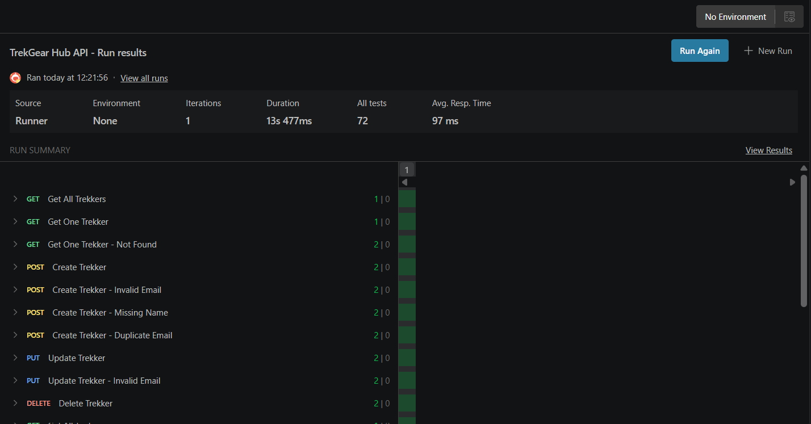
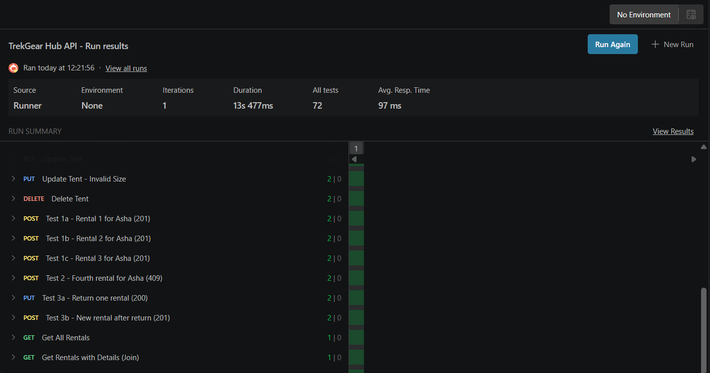
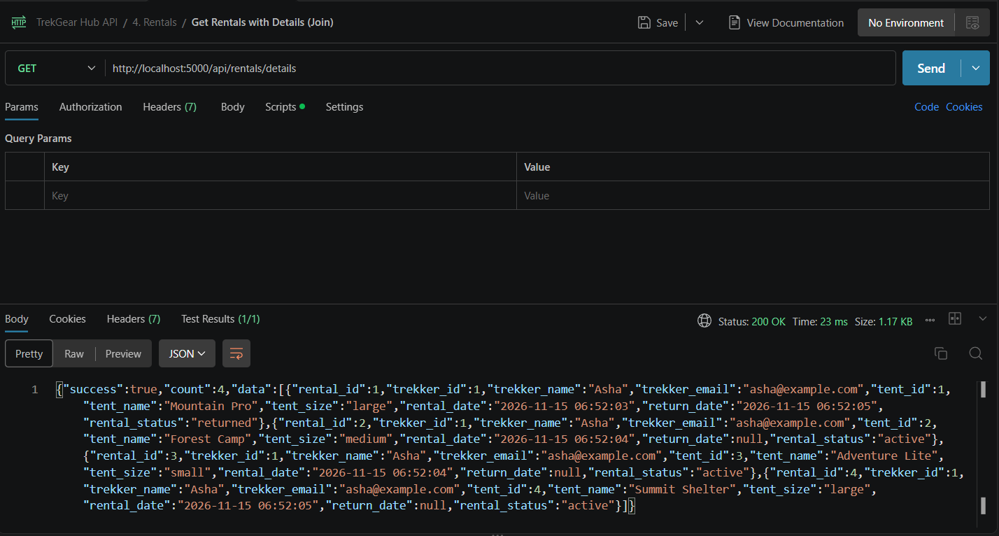
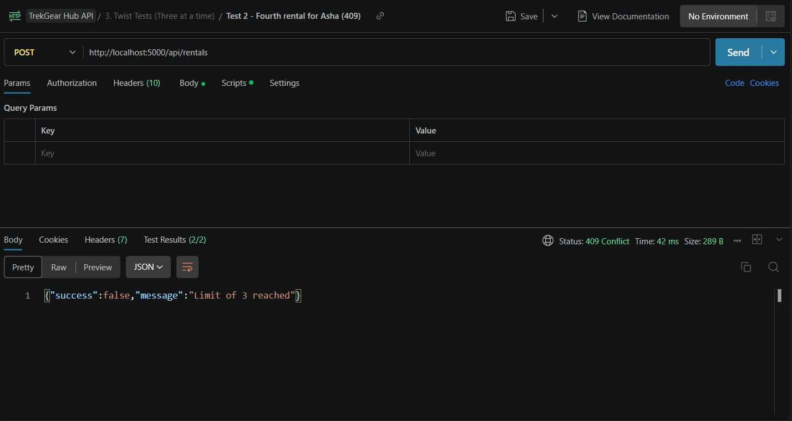

# TrekGear Hub – Backend API

## 1. Project Overview

TrekGear Hub is a backend application for a trekking gear shop that rents out tents. It manages trekkers, tents and rentals, stops tents from being double-rented, keeps damaged tents out of circulation, and limits every trekker to 3 active rentals.

It is built with Node.js and Express.js for the REST APIs and SQLite for the relational database.

## 2. Features

- Full CRUD for trekkers and tents.
- Create and return rentals, with the tent status updated automatically.
- Damaged or already rented tents cannot be rented.
- Three-at-a-time rule: a trekker can have at most 3 active rentals.
- JOIN endpoint that shows rentals with the trekker name and the tent name.
- Search tents by size using a query parameter.
- Input validation with clear error messages.

## 3. Technologies Used

| Technology | Purpose |
| --- | --- |
| Node.js | JavaScript runtime |
| Express.js | Backend web framework |
| SQLite (sqlite3, sqlite) | Relational database |
| Postman | API testing |
| Git and GitHub | Version control |

## 4. Project Structure

```
TrekGear-Hub/
├── database/
│   └── db.js
├── routes/
│   ├── trekkers.js
│   ├── tents.js
│   └── rentals.js
├── postman/
├── screenshots/
├── helpers.js
├── server.js
├── package.json
├── .gitignore
└── README.md
```

- **server.js:** starts the Express server and registers the routes.
- **database/db.js:** opens SQLite, creates the 3 tables and adds sample data.
- **helpers.js:** small helper functions for ID and email checks.
- **routes/:** one file each for trekkers, tents and rentals.
- **postman/:** exported Postman collection.
- **screenshots/:** screenshots of the API testing.

## 5. Database Design

Database file: `database/trekgear.db` (created automatically).

| Table | Columns |
| --- | --- |
| trekkers | id, name, email (unique), phone |
| tents | id, name, size (small, medium, large), condition (good, damaged), status (available, rented, maintenance) |
| rentals | id, trekker_id, tent_id, rental_date, return_date, status (active, returned) |

`rentals.trekker_id` and `rentals.tent_id` are foreign keys, so every rental is linked to one trekker and one tent.

Sample data: 3 trekkers (Asha, Rahul, Priya) and 6 tents. One tent is damaged.

## 6. Installation and Setup

Prerequisites: Node.js, npm, VS Code, Postman.

```
git clone https://github.com/sujalsharma008/TrekGear-Hub.git
cd TrekGear-Hub
npm install
npm start
```

The server runs at `http://localhost:5000`.

If `sqlite3` asks for permission to run its install script:

```
npm install-scripts approve sqlite3
npm rebuild sqlite3
```

To restart with fresh data, stop the server, delete `database/trekgear.db` and run `npm start` again.

## 7. API Documentation

Base URL: `http://localhost:5000`

### Trekker APIs

| Method | Endpoint | Description |
| --- | --- | --- |
| GET | `/api/trekkers` | Get all trekkers |
| GET | `/api/trekkers/:id` | Get one trekker |
| POST | `/api/trekkers` | Add a trekker |
| PUT | `/api/trekkers/:id` | Update a trekker |
| DELETE | `/api/trekkers/:id` | Delete a trekker |

Request body for POST:

```
{ "name": "Neha", "email": "neha@example.com", "phone": "9876543299" }
```

A trekker with rental history cannot be deleted.

### Tent APIs

| Method | Endpoint | Description |
| --- | --- | --- |
| GET | `/api/tents` | Get all tents |
| GET | `/api/tents?size=large` | Search tents by size |
| GET | `/api/tents/:id` | Get one tent |
| POST | `/api/tents` | Add a tent |
| PUT | `/api/tents/:id` | Update a tent |
| DELETE | `/api/tents/:id` | Delete a tent |

Request body for POST:

```
{ "name": "Sky Dome", "size": "medium" }
```

A tent marked `damaged` moves to `maintenance`. A rented tent cannot be deleted.

### Rental APIs

| Method | Endpoint | Description |
| --- | --- | --- |
| GET | `/api/rentals` | Get all rentals |
| GET | `/api/rentals/details` | Rentals with trekker name and tent name (JOIN) |
| GET | `/api/rentals/:id` | Get one rental |
| POST | `/api/rentals` | Create a rental |
| PUT | `/api/rentals/:id/return` | Return a rental |
| DELETE | `/api/rentals/:id` | Delete a rental |

Request body for POST:

```
{ "trekker_id": 1, "tent_id": 1 }
```

Creating a rental makes the tent `rented`. Returning it makes the tent `available` again.

## 8. The Twist: Three at a Time

A trekker can hold at most 3 active rentals. The 4th attempt returns **409** with the message `Limit of 3 reached`. Returning a rental frees one place.

```
{ "success": false, "message": "Limit of 3 reached" }
```

| Test | Steps | Expected Result |
| --- | --- | --- |
| Test 1 | Create 3 rentals for Asha | 201, 201, 201 |
| Test 2 | Create a 4th rental for Asha | 409 |
| Test 3 | Return one rental, then create a new one | 201 |

## 9. Validation and Error Handling

- Trekker: name and email required, valid email format, unique email.
- Tent: name required, size must be small, medium or large, condition must be good or damaged.
- Rental: valid `trekker_id` and `tent_id`, both must exist, tent must be available and in good condition, limit of 3 active rentals.
- Broken JSON and unknown routes return a clear error.

| Status Code | Meaning |
| --- | --- |
| 200 | Request successful |
| 201 | Created |
| 400 | Invalid input |
| 404 | Not found |
| 409 | Conflict (duplicate email, tent not available, damaged tent, limit reached) |
| 500 | Server error |

All errors use this format:

```
{ "success": false, "message": "Size must be small, medium or large" }
```

## 10. API Testing

The APIs are tested with Postman. The collection is in the `postman/` folder and has 40 requests with test scripts that check the status code and the message.

Folders in the collection: Trekkers, Tents, Twist Tests and Rentals.

To run it:

1. Delete `database/trekgear.db` and start the server for fresh data.
2. Import `postman/TrekGear-Hub.postman_collection.json` into Postman.
3. Run the collection.

### Screenshots

**Collection run (72 tests passed)**



**Twist tests (Test 1, Test 2 and Test 3)**



**Join endpoint (rentals with trekker name and tent name)**



**Test 2: 4th rental returns 409 Limit of 3 reached**



## 11. Future Improvements

- Add authentication.
- Add rental due dates and late return tracking.
- Add a damage report when a tent is returned.
- Build a frontend for the shop staff.

## 12. Team Members (LG - 06)

| S. No. | Team Member | Registration Number |
| --- | --- | --- |
| 1 | SUJAL SHARMA      | 252U1R9152 |
| 2 | TEJA SREE         | 252U1R9139 |
| 3 | VINIT KUMAR NAYAK | 252U1R9169 |
| 4 | NITHIKA           | 252U1R9158 |
| 5 | AMRUTHA           | 252U1R9141 |

## 13. Project Information

**Project:** TrekGear Hub – Backend Development Group Assignment (Modules 1 to 3)

**Group:** JP-GAI2C-G06

**Technologies:** Node.js, Express.js, SQLite, JavaScript

**Testing Tool:** Postman

**Repository:** https://github.com/sujalsharma008/TrekGear-Hub-Group